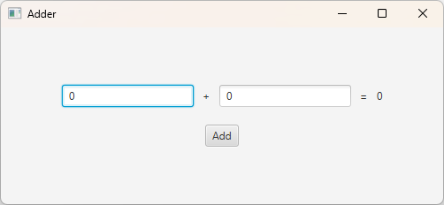
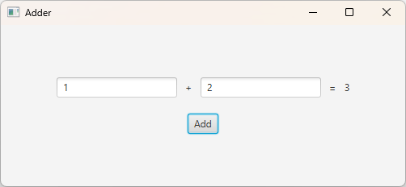

# Assignment 6-2: JavaFX Adder

Name:

ID:

## Problem Overview

Create a JavaFX application that takes two numbers as input and add them.

## Setup and Environment

- **WARNING:** Do not modify the `.github` or `gradle-tests` directories. These directories are essential for the automated grading process, and any changes may result in incorrect grading.

Refer to the provided `Maven Basics` and `Maven Basics for JavaFX Applications` documents for instructions on setting up the project and running the application.

## Requirements and Specifications

### Instructions

- Create a JavaFX application following these specifications:
  - The `Scene` size is 500 (width) x 200 (height).
  - Include 2 `TextField`s and a `Button` with the text `Add`.
  - Add decorative labels with the symbols `+` and `=` to visually represent the addition operation.
  - All controls should be centered. Make sure the application looks as close to the provided example as possible.

## Input/Output Conditions

When the application starts, it should look like this:

When numbers are entered into the `TextField`s and the `Add` button is clicked, it should display the addition result, as shown below:

